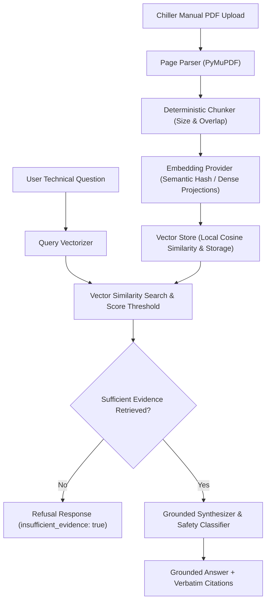

# Enterprise RAG for Chiller Manuals

A retrieval-augmented generation system engineered for industrial chiller technical manuals, delivering strictly grounded technical answers with document, page, and chunk-level citations.

Status: Pre-release / Technical Portfolio Demonstration (v0.1.0).

---

## Key Capabilities

- **Grounded Technical Q&A**: Generates responses strictly derived from retrieved manual passages, preventing speculative or fabricated answers.
- **Auditable Citations**: Every claim is linked to the source manual filename, page number, chunk ID, and exact verbatim excerpt.
- **Refusal on Insufficient Evidence**: Automatically flags `insufficient_evidence: true` and refuses to generate answers when relevant documentation is missing.
- **Mandatory Safety Notices**: Detects safety-sensitive queries (voltage, high pressure, refrigerant handling, lockout/tagout) and injects mandatory safety warnings.
- **Pluggable Architecture**: Replaceable interfaces for PDF extraction, chunking, embeddings (`LocalSemanticHashEmbeddingProvider` / `FakeEmbeddingProvider`), vector storage (`LocalVectorStore`), and generation (`GroundedRuleLlmProvider`).
- **Deterministic Offline Testing**: Works without paid external APIs or cloud vector services for zero-dependency local evaluation and CI test suites.

---

## Architecture Overview



---

## Repository Structure

```text
enterprise-rag-chiller-manuals/
├── .github/
│   └── workflows/
│       └── ci.yml
├── src/
│   └── chiller_rag/
│       ├── __init__.py
│       ├── api.py           # FastAPI REST endpoints
│       ├── chunker.py       # Overlap-aware chunking
│       ├── config.py        # System configuration
│       ├── embeddings.py    # Embedding protocols & local hash provider
│       ├── engine.py        # RAG coordinator engine
│       ├── generator.py     # Grounded answering & citation logic
│       ├── models.py        # Pydantic data schemas
│       ├── pdf_parser.py    # Independent PDF page extractor
│       └── vector_store.py  # Local vector storage with persistence
├── tests/
│   ├── conftest.py          # Synthetic chiller manual fixtures
│   ├── test_api.py          # REST API integration tests
│   ├── test_chunker.py      # Chunker boundary tests
│   ├── test_embeddings.py   # Embedding vector tests
│   ├── test_pdf_parser.py   # PDF parsing tests
│   ├── test_retrieval_and_grounding.py # Evidence and citation tests
│   └── test_vector_store.py # Storage, filter, and purge tests
├── .env.example
├── .gitignore
├── pyproject.toml
├── README.md
└── SECURITY.md
```

---

## Technology Choices

- **Python 3.11+**: Fast execution, modern type hinting, and consistent cross-platform packaging.
- **NumPy**: High-speed vector arithmetic and cosine similarity calculation without external database servers.
- **FastAPI & Pydantic v2**: High-throughput REST API with strict request/response data contracts.
- **PyMuPDF**: Robust PDF ingestion extracting clean per-page text streams.
- **Local Dense Projections**: Enables zero-download, deterministic vector search for testing and offline air-gapped deployments.

---

## Prerequisites

- Python 3.11+ or `uv` package manager.
- No external vector databases or paid LLM API keys are required for core operation or testing.

---

## Installation & Setup

```bash
# Clone the repository
git clone https://github.com/baerozgaarmard/enterprise-rag-chiller-manuals.git
cd enterprise-rag-chiller-manuals

# Initialize virtual environment
uv venv --python 3.11 .venv
# On Windows:
.venv\Scripts\activate
# On Linux/macOS:
# source .venv/bin/activate

# Install package and test dependencies
uv pip install -e ".[dev]"
```

---

## Configuration

Settings are controlled through environment variables:

| Variable | Description | Required | Default |
| --- | --- | --- | --- |
| `CHILLER_RAG_HOST` | API bind address | No | `127.0.0.1` |
| `CHILLER_RAG_PORT` | API port | No | `8001` |
| `CHILLER_RAG_DATA_DIR` | Storage path for local vector database | No | `./data` |
| `CHILLER_RAG_CHUNK_SIZE` | Chunk size in characters | No | `500` |
| `CHILLER_RAG_CHUNK_OVERLAP` | Overlap between adjacent chunks | No | `80` |
| `CHILLER_RAG_SIMILARITY_THRESHOLD` | Minimum cosine similarity to consider evidence | No | `0.20` |
| `CHILLER_RAG_TOP_K` | Number of chunks retrieved per question | No | `4` |
| `CHILLER_RAG_EMBEDDING_PROVIDER` | `local` (semantic hash) or `fake` | No | `local` |
| `CHILLER_RAG_LLM_PROVIDER` | `grounded_rule` or `fake` | No | `grounded_rule` |
| `OPENAI_API_KEY` | Optional API key for external LLM backends | No | None |

---

## Running Locally

### Start API Server

```bash
uvicorn chiller_rag.api:app --host 127.0.0.1 --port 8001 --reload
```

Interactive OpenAPI documentation is available at `http://127.0.0.1:8001/docs`.

---

## API Usage Examples

### 1. Ingest a Chiller Manual

```bash
curl -X POST "http://127.0.0.1:8001/v1/documents" \
  -H "accept: application/json" \
  -H "Content-Type: multipart/form-data" \
  -F "file=@chiller_manual.pdf"
```

Response:
```json
{
  "document_id": "doc_8f1a2b3c",
  "filename": "chiller_manual.pdf",
  "page_count": 2,
  "indexed_at": "2026-11-22T17:45:00Z",
  "chunk_count": 4
}
```

### 2. Submit Technical Query

```bash
curl -X POST "http://127.0.0.1:8001/v1/query" \
  -H "Content-Type: application/json" \
  -d '{"question": "What refrigerant does the Model X500 use?"}'
```

Response:
```json
{
  "answer": "According to the chiller manual documentation: The Model X500 Centrifugal Chiller operates exclusively on R-134a refrigerant with a factory charge of 450 lbs.",
  "insufficient_evidence": false,
  "citations": [
    {
      "document_id": "doc_8f1a2b3c",
      "filename": "chiller_manual.pdf",
      "page_number": 1,
      "chunk_id": "doc_8f1a2b3c_p1_c0",
      "quote": "The Model X500 Centrifugal Chiller operates exclusively on R-134a refrigerant with a factory charge of 450 lbs."
    }
  ],
  "retrieval": {
    "result_count": 1,
    "max_score": 0.8421
  }
}
```

### 3. Inspect Retrieved Passages (Debug Endpoint)

```bash
curl -X POST "http://127.0.0.1:8001/v1/retrieve" \
  -H "Content-Type: application/json" \
  -d '{"query": "refrigerant pressure limits", "top_k": 2}'
```

### 4. Delete Manual

```bash
curl -X DELETE "http://127.0.0.1:8001/v1/documents/doc_8f1a2b3c"
```

---

## Testing & Quality Gates

Run the test suite and static checks:

```bash
# Run 13 unit and integration tests
pytest -v

# Check style and formatting
ruff check .
ruff format --check .
```

---

## Safety & Grounding Principles

1. **No Hallucination**: If the vector similarity score does not satisfy the confidence threshold or key terms are absent, the system flags `insufficient_evidence: true` and refuses to invent specifications.
2. **Mandatory LOTO Disclaimers**: Operating limits on refrigerant pressure, electrical components, and compressor mechanics automatically append explicit warnings directing operators to follow manufacturer Lockout/Tagout procedures.
3. **Data Isolation**: Document IDs allow scoping queries to specific machines or fleet serials, preventing cross-manual data contamination.

---

## Known Limitations

- Multi-column tables with complex merged cells are parsed as standard text blocks.
- Mathematical curve equations embedded in raster images require separate extraction prior to ingestion.

---

## License

This project is licensed under the MIT License.
